# Germline Variant Discovery and HLA Analysis from Whole-Exome Sequencing

This project implements an end-to-end **germline variant-calling workflow** using a public whole-exome sequencing (WES) dataset, followed by a focused analysis of variants overlapping human leukocyte antigen (**HLA**) genes.

The main objective is to practice and document a reproducible WES analysis workflow, then explore the potential functional consequences of variants in HLA genes. The HLA region is highly polymorphic and encodes molecules involved in antigen presentation and immune recognition. For that reason, examining variation in HLA genes provides a useful example of how genome-wide variant calls can be narrowed to a biologically relevant genomic region and followed by functional annotation.

**Dataset:** [SRR12083525](https://www.ncbi.nlm.nih.gov/sra/?term=SRR12083525), from the NCBI Sequence Read Archive (SRA).

The complete analysis—including commands, parameter explanations, quality-control figures, results, and interpretation—is available in [`germline_variant_analysis.ipynb`](germline_variant_analysis.ipynb).

> **Scope:** This is an exploratory analysis of one public WES dataset. Variant annotations and predicted protein consequences are not clinical interpretations, and this project does not establish disease associations or experimental effects.

## Workflow

The analysis follows these main steps:

1. Download paired-end sequencing reads from the NCBI SRA and assess raw-read quality.
2. Trim adapters and low-quality bases, then reassess read quality.
3. Align reads to the human reference genome (hg38) and process the alignments.
4. Call germline SNPs and small insertions/deletions (indels) with GATK.
5. Apply variant-level filters and retain variants marked `PASS`.
6. Extract variants overlapping HLA genes using coordinates from GENCODE v45.
7. Annotate HLA-region variants with ANNOVAR and examine selected annotations and predicted protein consequences.

```mermaid
flowchart LR
    A[SRA download<br/>prefetch + fasterq-dump] --> B[FastQC<br/>raw reads]
    B --> C[Trimmomatic]
    C --> D[FastQC<br/>trimmed reads]
    D --> E[BWA-MEM<br/>hg38]
    E --> F[SAMtools<br/>sort + index]
    F --> G[Picard<br/>MarkDuplicates]
    G --> H[GATK<br/>HaplotypeCaller]
    H --> I[SNP / indel<br/>hard filtering]
    I --> J[PASS variants<br/>bcftools stats]
    J --> K[HLA gene intervals<br/>GENCODE v45]
    K --> L[ANNOVAR<br/>annotation]
    L --> M[Variant interpretation]
```



## Key results

| Analysis step | Result |
|---|---:|
| Input sequencing data | 29,371,176 paired-end read pairs |
| Read pairs retained as pairs after trimming | 87.59% |
| Properly paired alignments | 99.12% |
| Duplicate rate | 0.69% |
| PASS variants | 112,495 |
| └ SNPs | 97,268 |
| └ Indels | 15,227 |
| Genome-wide Ti/Tv ratio | 2.32 |
| Variants overlapping HLA genes | 37 |
| └ SNPs | 35 |
| └ Indels | 2 |

### HLA annotation overview

The 37 variants overlapping the selected HLA gene intervals were annotated using ANNOVAR. The table summarizes the annotations reported in the notebook.

| Gene | Total variants | Exonic variants | Nonsynonymous | Frameshift |
|---|---:|---:|---:|---:|
| HLA-A | 5 | 4 | 3 | 0 |
| HLA-H | 1 | 0 | 0 | 0 |
| HLA-DRB1 | 5 | 5 | 1 | 2 |
| HLA-DQA1 | 22 | 5 | 3 | 0 |
| HLA-DQB1 | 3 | 3 | 2 | 0 |
| HLA-DQB1-AS1 | 1 | 0 | 0 | 0 |

The notebook further discusses selected HLA-A variants in relation to peptide-binding pockets and two annotated frameshift variants in HLA-DRB1. These interpretations are exploratory and should be considered in light of the limitations of variant calling and annotation in the highly polymorphic HLA region.

## Tools and resources

**Software:** SRA Toolkit, FastQC, Trimmomatic, BWA-MEM, SAMtools, BCFtools, Picard, GATK 4.6.2.0, and ANNOVAR.

**Reference resources:**
- Human reference genome: [UCSC hg38](https://hgdownload.gi.ucsc.edu/goldenPath/hg38/bigZips/)
- Gene annotation: [GENCODE v45](https://www.gencodegenes.org/human/release_45.html)
- Variant annotation databases: refGene, ClinVar, gnomAD exome, and dbNSFP (see the notebook for the specific database versions and commands).

## Repository contents

```text
.
├── germline_variant_analysis.ipynb   # Complete analysis
├── figures/                          # FastQC figures displayed in the notebook
├── environment.yml                   # Conda environment specification
├── .gitignore
├── LICENSE
└── README.md
```

Raw sequencing reads, the reference genome, intermediate BAM/VCF files, and downloaded annotation databases are not included because of their size. They are generated or downloaded during the workflow and are excluded from version control (see `.gitignore`).

## Reproducing the analysis

The workflow is documented in the notebook and is intended to be run from a Linux, macOS, or WSL environment with a Python/IPython kernel. Whole-exome alignment and variant calling can require substantial disk space and several hours, depending on the available hardware.

### 1. Create the software environment

Install [Conda](https://docs.conda.io/) or a compatible distribution, then run:

```bash
conda env create -f environment.yml
conda activate germline-wes
```

Picard and ANNOVAR require separate setup:

- **Picard:** The notebook invokes Picard using `java -jar ~/tools/picard.jar`. Download the JAR from the [Picard releases](https://github.com/broadinstitute/picard/releases), or update the path in the notebook to match its location.
- **ANNOVAR:** ANNOVAR requires academic registration. Follow the instructions at the [ANNOVAR website](https://annovar.openbioinformatics.org/) to obtain and install it. The notebook documents the database download and annotation commands used in this analysis.

### 2. Download the reference files

The notebook expects the reference files in:

```text
~/germline_variant_analysis/reference/
```

Required files:

- `hg38.fa` — the hg38 reference FASTA from [UCSC](https://hgdownload.gi.ucsc.edu/goldenPath/hg38/bigZips/).
- `gencode.v45.annotation.gtf` — the [GENCODE v45 comprehensive gene annotation](https://www.gencodegenes.org/human/release_45.html).

The notebook also uses this project working directory:

```text
~/germline_variant_analysis/
```

If you use a different directory, update the corresponding path settings in the notebook before running it.

### 3. Run the notebook

Start Jupyter from the repository directory and run `germline_variant_analysis.ipynb` from top to bottom. The notebook uses IPython shell commands (`!`) and `%%bash` cells, so it requires an IPython-compatible kernel and a Unix-like environment.

The HLA BED-file generation step uses GNU awk (`gawk`), which is included in the Conda environment.

## Data and interpretation notes

- The sequencing dataset, SRR12083525, is publicly available through the [NCBI SRA](https://www.ncbi.nlm.nih.gov/sra/?term=SRR12083525).
- The HLA intervals were derived from GENCODE v45 gene annotations. The exact extraction procedure is documented in the notebook.
- HLA genes are highly polymorphic, and short-read alignment and variant calling in this region can be challenging. The reported calls and annotations should therefore be treated as exploratory results rather than definitive genotypes or clinical findings.
- Check the original study's data-use terms before redistributing derived files, such as VCFs.
- ANNOVAR and third-party databases have their own terms and licensing conditions.

## License

The code and text in this repository are released under the MIT License (see [`LICENSE`](LICENSE)). Third-party tools, annotation databases, and reference resources remain subject to their respective licenses and terms of use.
